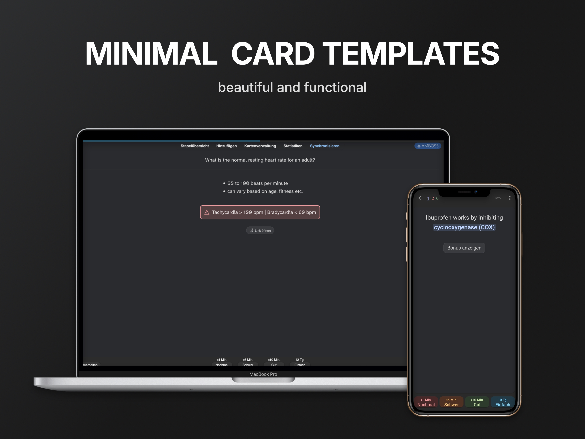

# Anki card template

A clean, readable card template for [Anki](https://apps.ankiweb.net/) with light and dark mode, a red **Important** box, a blue **Mnemonic** box, a collapsible **Bonus** section, and a **Link** button that opens any URL (for example a YouTube video). A basic as well as a close version of the card is included.

## Features

- Light and dark mode (follows Anki's night mode)
- Optional **Important** box (red) for pitfalls and key facts
- Optional **Mnemonic** box (blue) which can be used for memory aids, as well as background information
- Optional **Bonus** section, collapsed until you click the button
- Optional **Link** button in the same style, opening a URL from a field
- Empty optional fields leave no gaps, and the button row hides itself when there are no buttons
- Uses [Atkinson Hyperlegible Next](https://fonts.google.com/specimen/Atkinson+Hyperlegible+Next)

## Fields

Create a note type with these fields:

| Field | Required | Purpose |
| --- | --- | --- |
| `Vorderseite` | yes | Front of the card (question) |
| `Rückseite` | yes | Back of the card (answer) |
| `Wichtig` | no | callout for important facts and pitfalls |
| `Eselsbrücke` | no | mnemonics, background information|
| `Bonus` | no | Extra content, hidden until the Bonus button is clicked |
| `Link` | no | URL; shows a "Link öffnen" button when filled |

## Link button

Put a plain URL in the `Link` field, for example `https://www.youtube.com/watch?v=...`. On desktop the link opens in your default browser. 

## Installation

1. In Anki, open **Tools → Manage Note Types**, select your note type, and click **Fields** to add the fields above.
2. Click **Cards…** for that note type.
3. Paste the contents of [`templates/front.html`](templates/front.html) into **Front Template**.
4. Paste the contents of [`templates/back.html`](templates/back.html) into **Back Template**.
5. Paste the contents of [`style.css`](style.css) into **Styling**.

## Cloze note type

The [`cloze/`](cloze) folder contains the same design for Anki's **Cloze** note type: pastel-blue cloze deletions, the red **Important** box, the blue **Mnemonic** box, the **Bonus** button, the **Link** button, and an extra **Image** field.

### Fields

| Field | Required | Purpose |
| --- | --- | --- |
| `Text` | yes | Cloze text, for example `The {{c1::axillary nerve}} supplies the deltoid` |
| `Bild` | no | Image, shown below the text |
| `Kasten` | no | Content of the red "Important" box |
| `Eselsbrücke` | no | Content of the blue "Mnemonic" box |
| `Bonus` | no | Extra content, hidden until the Bonus button is clicked |
| `Link` | no | A URL; shows a "Link öffnen" button when filled |

### Installation

1. Create a note type based on **Cloze** (Tools → Manage Note Types → Add → "Add: Cloze") and add the fields above.
2. Click **Cards…** and paste [`cloze/front.html`](cloze/front.html) into **Front Template**.
3. Paste [`cloze/back.html`](cloze/back.html) into **Back Template**.
4. Paste [`cloze/style.css`](cloze/style.css) into **Styling**.

The cloze styling is the main `style.css` plus the cloze rules, so use `cloze/style.css` for this note type.

## Font

Atkinson hyperlegible next is a font created by Braille Institute designed to improve legibility and readability. Features of the font are  clear,  distinctive letters and numbers that make reading easier. 

## AI usage
Claude code was used to clean my code up since I am not a professional develope. It was also used to translate my comments etc. from German into English.

## License

MIT, see [LICENSE](LICENSE).
