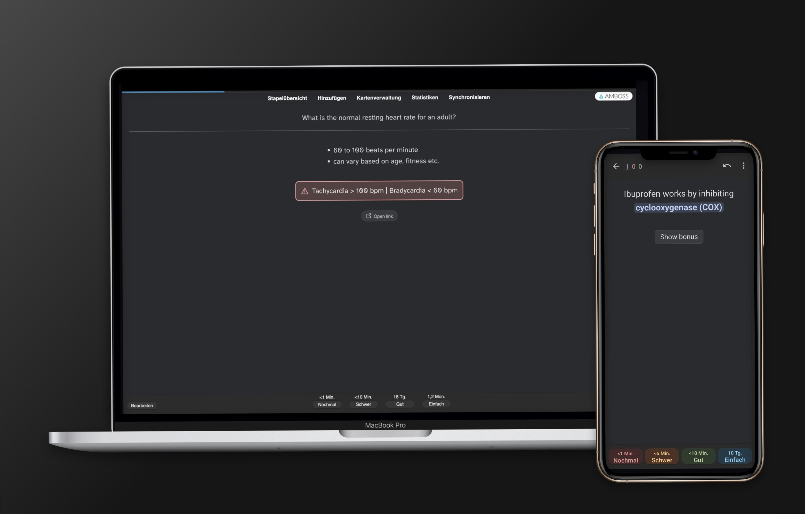

# Anki Card Template

A minimal, readable card template for [Anki](https://apps.ankiweb.net/) with automatic light and dark mode, highlighted callout boxes, a collapsible bonus section, and a link button. Includes a **Basic** and a **Cloze** note type that share the same design. Perfect for your med school flashcards or any other topic you study!

## Features

- **Light and dark mode**, following Anki's night mode
- **Important box** (red) for pitfalls and key facts
- **Mnemonic box** (blue) for memory aids and background information
- **Bonus section**, collapsed until you click the button
- **Link button** that opens a URL from a field, for example a YouTube video
- **No empty gaps:** unused optional fields render nothing, and the button row hides itself when there are no buttons
- **Cloze support** with pastel-blue deletions and an additional image field
- **Highly legible typography** using [Atkinson Hyperlegible Next](https://fonts.google.com/specimen/Atkinson+Hyperlegible+Next)
- Plain HTML and CSS plus a few lines of JavaScript; no add-ons required

## Repository structure

| Path | Contents |
| --- | --- |
| [`templates/`](templates) | Front template, back template and styling for the Basic note type |
| [`cloze/`](cloze) | Front template, back template and styling for the Cloze note type |
| [`style.css`](style.css) | Copy of `templates/style.css` |

## About this project and AI disclosure

I started this project years ago in my spare time during medical school with the help of YouTube tutorials, Reddit and StackOverflow posts. I am not a professional developer, and not every feature worked flawlessly. Now I used Claude Code to clean up the code, get the buttons working like I planned and to translate it into English.

Feedback is welcome.

## Basic note type

### Fields

Create a note type with these fields:

| Field | Required | Purpose |
| --- | :---: | --- |
| `Front` | ✓ | Front of the card (question) |
| `Back` | ✓ | Back of the card (answer) |
| `Important` | | Red callout for key facts and pitfalls |
| `Mnemonic` | | Blue callout for memory aids and background information |
| `Bonus` | | Extra content, hidden until the Bonus button is clicked |
| `Link` | | URL; shows an **Open link** button when filled |

### Installation

1. In Anki, go to **Tools → Manage Note Types**, select your note type (or add a new one), and click **Fields** to add the fields above.
2. Click **Cards…** for that note type.
3. Paste the contents of [`templates/front.html`](templates/front.html) into **Front Template**.
4. Paste the contents of [`templates/back.html`](templates/back.html) into **Back Template**.
5. Paste the contents of [`templates/style.css`](templates/style.css) into **Styling**.

## Cloze note type

The [`cloze/`](cloze) folder contains the same design for Anki's **Cloze** note type, with pastel-blue cloze deletions and an additional image field.

### Fields

| Field | Required | Purpose |
| --- | :---: | --- |
| `Text` | ✓ | Cloze text, e.g. `The {{c1::axillary nerve}} supplies the deltoid` |
| `Image` | | Image shown below the text |
| `Important` | | Red callout for key facts and pitfalls |
| `Mnemonic` | | Blue callout for memory aids and background information |
| `Bonus` | | Extra content, hidden until the Bonus button is clicked |
| `Link` | | URL; shows an **Open link** button when filled |

### Installation

1. Create a note type based on **Cloze** (**Tools → Manage Note Types → Add → Add: Cloze**) and add the fields above.
2. Click **Cards…** and paste [`cloze/front.html`](cloze/front.html) into **Front Template**.
3. Paste [`cloze/back.html`](cloze/back.html) into **Back Template**.
4. Paste [`cloze/style.css`](cloze/style.css) into **Styling**.

> The cloze stylesheet is the Basic stylesheet plus the cloze rules, so always use `cloze/style.css` for the Cloze note type.

## Usage notes

**Link button.** Put a plain URL in the `Link` field, e.g. `https://www.youtube.com/watch?v=...`. On desktop, the link opens in your default browser.

**Font.** The templates request *Atkinson Hyperlegible Next*, but the font is not bundled. To use it, install it on each device you study on ([download from Google Fonts](https://fonts.google.com/specimen/Atkinson+Hyperlegible+Next)). Without it, the cards fall back to your system's default sans-serif font.

**Customization.** Colors, spacing and font size are defined in the stylesheet and can be changed directly in Anki's **Styling** tab.

## About the font

[Atkinson Hyperlegible](https://brailleinstitute.org/freefont) was created by the Braille Institute to improve legibility and readability. Its clear, distinctive letterforms make similar characters easier to tell apart, which is helpful when studying large volumes of text. Therefore I chose it for my template. 

## Contributing

Issues and pull requests are welcome. If you find a problem, please mention your Anki version and platform (desktop, AnkiDroid or AnkiMobile).

## License

Released under the [MIT License](LICENSE).
